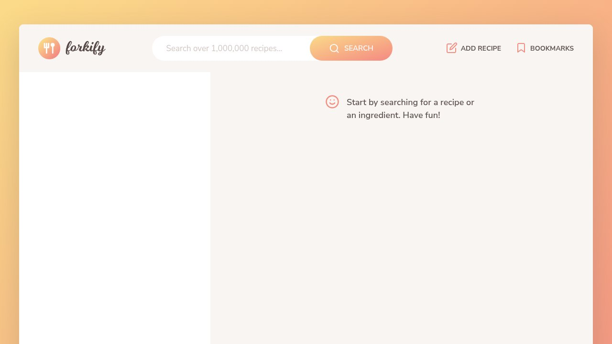

# Forkify

A recipe app: search recipes, open one, change the servings and the ingredient amounts update, bookmark favourites, and add your own recipe.

**Try it:** https://mhmd7710d.github.io/Forkify-project/



## What you can try
- Search for an ingredient, for example `pizza`, and pick a result.
- Change the servings with the minus and plus buttons and watch the quantities change.
- Bookmark a recipe (saved in the browser), or upload your own recipe.

## Built with
JavaScript with an MVC structure (model, views, controller), Sass, Parcel for bundling, and the Forkify API for the recipe data.

## What I practised
Splitting code into modules, async/await and error handling, working with a third-party API, pagination, and updating the page from state.

## Run it locally
```
npm install
npm start
```

## Credits
Original project from Jonas Schmedtmann's Complete JavaScript Course, all copyright to Jonas Schmedtmann. Personalized by Mohammad Fathi.

## Contact
- LinkedIn: https://www.linkedin.com/in/muhammad-fathi-b7a693424/
- X (Twitter): https://x.com/mouahid7710
- Facebook: https://www.facebook.com/share/1CQhxpCeYL/
- Instagram: https://www.instagram.com/mhmd7710d/
- Email: muhammutfathi@gmail.com
- WhatsApp: https://wa.me/201040428475?text=Hi+Mohammad%2C+I+found+your+project+on+GitHub.
